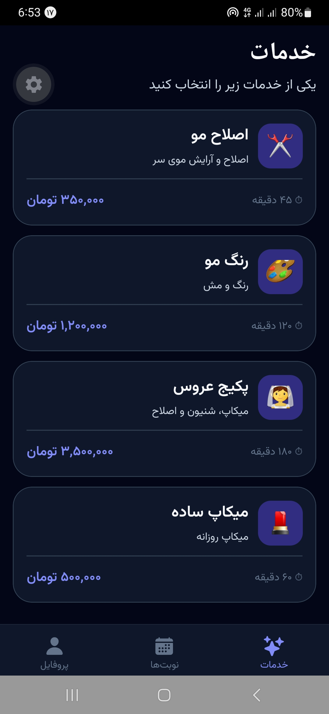
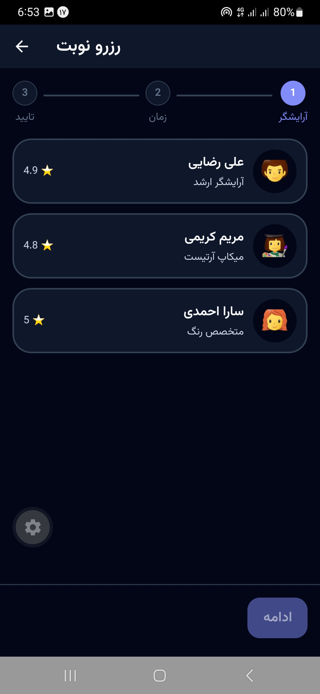
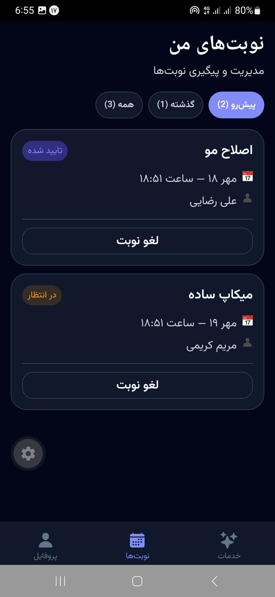
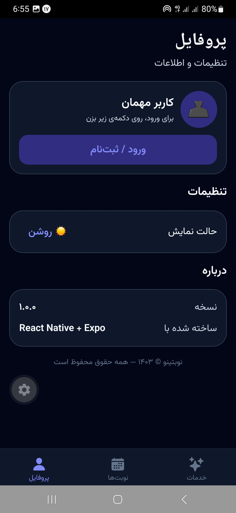

# 🌰 نوبتینو | Nobatino

> اپلیکیشن رزرو نوبت آرایشگاه و سالن زیبایی با React Native و Expo


## 📱 درباره‌ی پروژه

نوبتینو یک اپلیکیشن موبایل مدرن برای رزرو آنلاین نوبت آرایشگاه و سالن زیبایی است.
این پروژه با تمرکز بر **معماری تمیز**، **RTL کامل** و **تجربه‌ی کاربری روان** طراحی و پیاده‌سازی شده است.

## ✨ امکانات

- 🔐 ورود با شماره موبایل + OTP
- 🛍 لیست خدمات با کارت‌های ریسپانسیو
- 👤 انتخاب آرایشگر با امتیاز و تخصص
- 📅 انتخاب تاریخ و ساعت از تقویم شمسی
- ✅ تایید و ثبت نوبت با انیمیشن روان
- 📋 مدیریت نوبت‌ها با فیلتر پیش‌رو / گذشته / همه
- 🌙 دارک مود خودکار + دستی
- 📱 ریسپانسیو کامل (موبایل و تبلت)
- 🇮🇷 RTL کامل با فونت وزیرمتن
- ♿ دسترس‌پذیری (accessibility) با استانداردهای روز

## 🏗 معماری

```
src/
├── app/              # ناوبری و Providerها
├── core/             # تم، DI، کانفیگ، utility
├── shared/           # کامپوننت‌های مشترک و hookها
├── infrastructure/   # لایه‌ی HTTP و Storage
└── features/         # ماژول‌های دامنه (feature-based)
    ├── auth/
    ├── services/
    ├── booking/
    ├── appointments/
    └── profile/
```

### اصول طراحی

- **Feature-Based Architecture** — هر feature مستقل و self-contained
- **Dependency Inversion** — Repositoryها به interface وابسته‌ن، نه پیاده‌سازی
- **SOLID Principles** در همه‌ی لایه‌ها
- **Design Patterns**: Repository، Strategy، Factory، Adapter، Compound Components

## 🛠 استک فنی

| لایه | تکنولوژی |
|------|-----------|
| Framework | React Native + Expo |
| زبان | TypeScript (strict) |
| State | Zustand + TanStack Query |
| Navigation | React Navigation v6 |
| فرم | React Hook Form + Zod |
| انیمیشن | Reanimated 3 |
| فونت | وزیرمتن (Vazirmatn) |
| تقویم | react-native-ui-datepicker (Jalali) |
| تست | Jest + React Native Testing Library |
| کیفیت | ESLint + Prettier + TypeScript strict |

## 🚀 نصب و اجرا

```bash
# نصب پکیج‌ها
npm install

# اجرا در حالت توسعه
npx expo start

# اسکن QR Code با اپ Expo Go روی گوشی
```

## 📸 اسکرین‌شات‌ها

<div align="center">
  
  
  
  
</div>

## 🧪 تست و کیفیت

```bash
# بررسی تایپ‌ها
npm run typecheck

# بررسی کیفیت کد
npm run lint

# فرمت خودکار
npm run format
```

## 📄 لایسنس

MIT © ۱۴۰۳